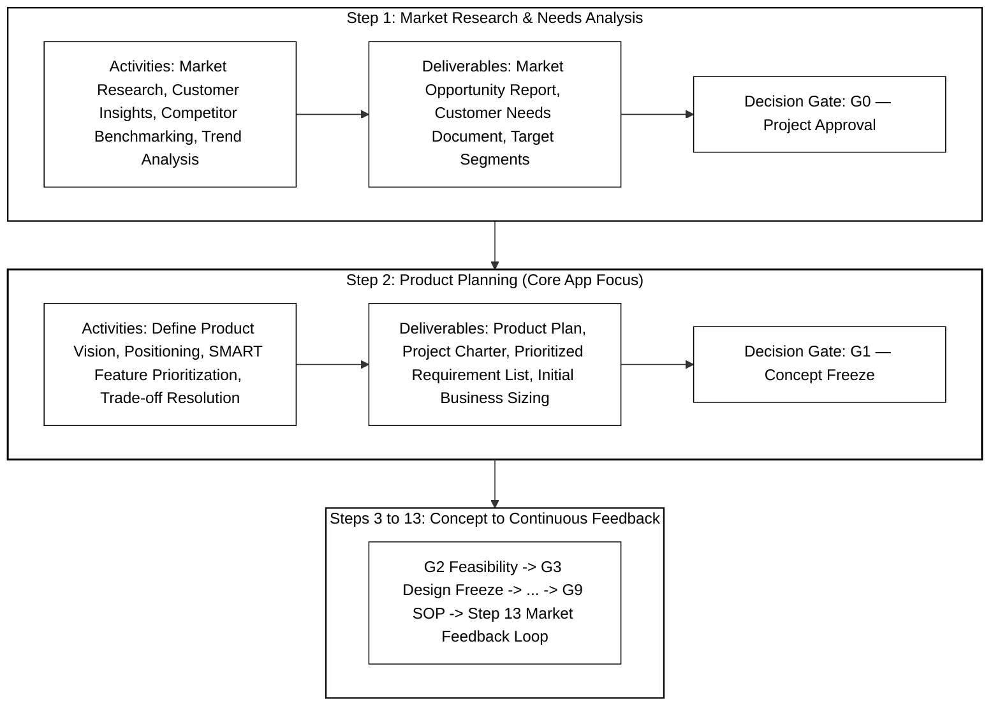

# BMW Product Management Challenge: Assignment Specification & Requirements Guide

**Challenge:** AI for Product Decision Making  
**Host:** BMW Group Product Management  
**Scope Focus:** Automotive Product Development Process — Steps 1 & 2 (Market Research & Product Planning to Gate G1 Concept Freeze)  
**Target Derivatives:** BMW 1 Series (F70), BMW 5 Series (G60/G68), BMW 7 Series (G70), and Future Successor Lines (Neue Klasse Architecture)  
**Target Markets:** Europe (EU), United States (US), China (CN), and Rest of World (RoW)  

---

## 1. Executive Summary & Mission Statement

Modern automotive product management requires synthesizing billions of fragmented market signals, customer reviews, warranty reports, competitor actions, and strategic corporate roadmaps into a coherent, customer-facing product specification. Today, this process spans approximately **two years** per vehicle generation and is predominantly manual, fragmented, and vulnerable to subjective bias.

### The Mission
Develop an AI-powered, human-in-the-loop enterprise application that:
1. **Ingests Heterogeneous Data**: Combines internal BMW customer feedback, quantitative satisfaction surveys, vehicle equipment catalogs, and strategic corporate reports.
2. **Extracts Actionable Signals**: Discovers recurring complaints, unmet customer needs, competitor advantages, and emerging market trends, each strictly linked to originating evidence.
3. **Derives SMART Product Requirements**: Formulates clear, customer-facing, realistic, and measurable requirements adhering to SMART criteria.
4. **Prioritizes with Explainable Logic**: Applies an objective, transparent, multi-factor scoring methodology that balances customer value, regional volume impact, corporate strategy, and implementation complexity.
5. **Keeps the Product Manager Firmly in the Loop**: Enables the PM to review, approve, reject, modify, or challenge requirements, rationales, and underlying evidence.
6. **Maintains a Forensic Audit Trail**: Chronologically logs every system derivation, PM intervention, score override, and decision rationale to guarantee end-to-end governance.

---

## 2. Automotive Product Development Process Alignment

BMW management explicitly bounded the scope of this challenge to **Steps 1 and 2** of the 13-stage Automotive Product Development Lifecycle:



### Boundary Definitions
* **In-Scope (Customer-Facing Product Attributes)**:
  * Interior comfort, ergonomics, and spatial packaging
  * Infotainment, operating system UX, and connected digital services
  * Climatization and thermal comfort controls
  * Driving experience and dynamic perception
  * Real-world charging UX and range perception
  * Equipment packaging, option bundling, and regional variant differentiation
* **Out-of-Scope**:
  * Regulatory and homologation compliance (e.g., UNECE safety, emissions type approval)
  * Low-level component specifications and supplier engineering schematics
  * Detailed unit economics, factory tooling capex, and bill-of-materials pricing calculations (rough implementation complexity/effort sizing is utilized as a prioritization factor)

---

## 3. Data Ecosystem & Inputs Profile

The application processes four distinct tiers of heterogeneous data:

```
BMW-Data/
├── F70_feedback_hackathon.xlsx              # 4,076 rows (1 Series - UK, JP, SE, FR)
├── G60_feedback_hackathon.xlsx              # 5,005 rows (5 Series - US, KR, GB, JP, SE)
├── G70_feedback_hackathon.xlsx              # 4,690 rows (7 Series - US, KR, JP, GB, CA)
├── F70_G60_G68_G70_customer_studies.xlsx    # Quantitative satisfaction studies (China, EU, US)
├── sales_volumes.xlsx                       # Market deliveries (2024, 2025, 2030 projections)
├── F70_OptionList.PDF                       # Official German equipment catalog & packaging (1er)
├── G60_OptionList.PDF                       # Official German equipment catalog & packaging (5er)
├── G70_OptionList.PDF                       # Official German equipment catalog & packaging (7er)
└── BMW_Group_Report_2025.pdf / Q-Deck       # 400-page strategic corporate & financial report
```

### Dataset Characteristics

| Dataset | Volume | Key Attributes | Strategic Value |
| :--- | :--- | :--- | :--- |
| **Customer Feedback** | 13,771 rows | `ID`, `Country`, `Engine Type` (ICE, BEV, PHEV), `Feedback Type` (Likes, DTU, Defect, Wants), `Customer Feedback`, `Vfc Category` | Voice of the customer; ground-truth operational friction, ergonomics, and feature desires. |
| **Customer Studies** | Quantitative sheets | Likert ratings (US) & Mean satisfaction scores (CN vs. EU) across 15 vehicle systems | Macro-level customer satisfaction benchmarks; correlates qualitative text with quantitative validation. |
| **Sales Volumes** | 4 regions $\times$ 3 vehicle lines | Volumes for 2024, 2025, and 2030 projections across EU, US, China, and RoW | Objective volume weighting factor for prioritization formulas. |
| **Option Catalogs** | 3 German PDFs | Standard vs. optional equipment, option codes, bundle packages (Innovation, Travel, Comfort) | Grounds proposed requirements in realistic production packaging. |
| **Strategic Report Deck** | ~400 pages | Neue Klasse platform roadmap, R&D priorities, BEV delivery targets, digital software KPIs | Strategic validation layer; ties customer desires to BMW engineering investments. |

---

## 4. Evaluation Criteria & Scoring Rubric

The challenge will be judged on five primary criteria, with one critical guiding principle:

| Dimension | Weight | Key Evaluation Requirements |
| :--- | :---: | :--- |
| **Decision & Scoring Logic** | 25% | Quality, consistency, and mathematical explainability of prioritization. Clear demonstration of how evidence sources are weighted and combined, and how trade-offs and conflicting signals are resolved. |
| **Workflow & Human Decision-Making** | 20% | Completeness of the end-to-end workflow from raw findings to prioritized requirements. Clearly defined roles, decision gates, and boundaries between autonomous AI and mandatory human review. |
| **Traceability & Auditability** | 20% | Full backward lineage from every requirement and score back to originating quotes, surveys, and report slides. Complete, chronological, tamper-evident audit history of all approvals, edits, and rejections. |
| **Solution Quality, Usability & Feasibility** | 20% | Prototype UI/UX polish, usability for BMW Product Managers and engineering peers, realistic applicability in an enterprise automotive environment, and quality of SMART formulations. |
| **Innovation, Scalability & Business Impact** | 15% | Originality of approach, cross-derivative scalability (F70 $\to$ G60 $\to$ G70 $\to$ Neue Klasse), reduction in manual requirement definition cycle time, and prevention of costly late-stage engineering rework. |

### The Winning Differentiator: "We Reward Honesty"
> **Direct Quote from BMW Challenge Evaluation Criteria:**  
> *"We reward honesty. Trustworthy AI acknowledges uncertainty. Show us where your app lacks evidence, encounters conflicting signals, or reaches uncertain conclusions, and how this is surfaced to the PM. Honest limitations are a strength, not a weakness."*

The application must include an explicit **Uncertainty & Evidence Confidence Index** that transparently highlights:
1. Low sample size / weak empirical support
2. Regional contradictions (e.g., EU Autobahn driver desires vs. China chauffeur comfort)
3. Extrapolations based on forward-looking assumptions (e.g., 2030 battery/software tech) versus proven historical data

---

## 5. SMART Requirements Framework

BMW requirements must strictly comply with the **SMART** standard:

| SMART Dimension | Definition | Automotive Context |
| :--- | :--- | :--- |
| **Specific** | Concrete and unambiguous system or feature scope | Exact UI component, sensor, or interior system |
| **Measurable** | Objective engineering/UX KPIs & thresholds | Clear quantifiable metrics (e.g. latency $< 45\text{ms}$, 60 fps) |
| **Attainable** | Feasible within vehicle architecture & manufacturing | Compatible with platform packaging & wiring harness |
| **Relevant** | Meaningfully solves verified customer pain | Directly resolves top complaint or aligns with brand strategy |
| **Timely** | Explicit SOP target & vehicle milestone | SOP 2028 (LCI / Successor / Neue Klasse milestone) |

### Benchmark Example: From Complaint to SMART Requirement
* **Raw Voice of Customer (`G70-0891`)**: *"Customer noted she would have chosen the Home theater screen, but it obstructs the view out the rear and BMW does not offer a camera/rear-view mirror screen."*
* **Unacceptable Requirement (Vague)**: *"Improve rear visibility when the theater screen is down."*
* **SMART Requirement (`REQ-G70-VIS-001`)**:
  * **Specific**: Full-display digital streaming rear-view mirror system utilizing an aerodynamic roof-mounted wide-angle camera feeding directly into the central rear-view mirror.
  * **Measurable**: End-to-end video latency $< 45\text{ ms}$; frame rate $\ge 60\text{ fps}$ at $1080\text{p}$; dynamic range $> 120\text{ dB}$ (headlight anti-glare); camera lens auto-defrosting and wash nozzle operational from $-30^\circ\text{C}$ to $+65^\circ\text{C}$.
  * **Attainable**: Integrates with the existing Neue Klasse roof shark-fin camera housing and high-speed automotive Ethernet backbone.
  * **Relevant**: Eliminates the #1 safety blocker preventing theater screen adoption; projected to increase Theater Screen package take-rate by 18%.
  * **Timely**: Targeted for SOP 2028 (G70 LCI / Neue Klasse Luxury derivative).
  * **Package Strategy**: Standard on i7 M70; optional in Innovation Package for base derivatives.

---

## 6. Key Mentors & Stakeholder Insights

1. **Bene_BMW (Product Management Pain Points)**:
   * *Cross-Market Regional Balancing*: Preferences differ radically by climate, usage habits, and culture. A single global specification often fails in either Europe, the US, or China.
   * *Predecessor Feedback Cycles*: Capturing field insights from outgoing models (e.g., F70, G60, G70) and projecting them 3–5 years ahead into future vehicle architectures.
   * *2-Year Timeline*: Requirement prioritization is not a one-time script; it is a collaborative, iterative governance process over ~24 months.
2. **ThomasFremuthBMW**:
   * Ground proposals in real evidence; maintain strict data hygiene (do not commit raw internal data to public repositories).
3. **Sebastian_BMW & ThomasBMW**:
   * Scope is tightly focused on Steps 1 & 2 of the automotive development framework.

---

## 7. Expected Deliverables

### 7.1 BMW-Provided Deliverable Wording

The following four expected deliverables are reproduced from the BMW wording supplied to the team.

#### 1. Concept and Demonstrable Prototype

> A concept and demonstrable prototype of an AI-powered product requirements application that processes heterogeneous inputs, derives product requirements, supports prioritization, and integrates human review.

#### 2. Structured Sample Requirements List

> A structured sample list of derived product requirements. Each requirement should include a unique identifier, a clear and actionable description, its linked findings and sources, a priority or score, the applied prioritization rationale, an evidence level, the key future-facing assumptions and uncertainties and its current decision status.

#### 3. End-to-End Workflow

> A clearly defined end-to-end workflow showing how inputs are processed into proposed and prioritized requirements, which activities the AI performs autonomously, and where human review is mandatory.

#### 4. Demonstrable Audit Trail

> A demonstrable audit trail that makes each requirement traceable from its underlying findings and sources through consolidation, scoring, prioritization, and human decision-making. It should record relevant changes to requirement content, scores, priorities, evidence, and status, including who or what initiated each change, when it occurred, and the documented rationale.

### 7.2 Delivery Checklist

- [ ] **Concept & Working Application Prototype**: Explain the concept and demonstrate heterogeneous input processing, derived product requirements, prioritization, and integrated human review.
- [ ] **Structured Sample Requirements List**: Include a unique identifier, clear and actionable description, linked findings and sources, priority or score, applied prioritization rationale, evidence level, key future-facing assumptions and uncertainties, and current decision status for every requirement.
- [ ] **End-to-End Workflow Definition**: Show how inputs become proposed and prioritized requirements, which activities the AI performs autonomously, and where human review is mandatory.
- [ ] **Traceable & Reconstructable Audit Trail**: Trace requirements from findings and sources through consolidation, scoring, prioritization, and human decisions. Record relevant content, score, priority, evidence, and status changes with initiator, timestamp, and rationale.

### 7.3 Presentation Deliverable

- [ ] **Pitch Presentation Deck (3–5 min)**: Compelling narrative demonstrating real-world value, data grounding, and Trustworthy AI principles.

See `IMPLEMENTATION_PLAN.md` for the concrete prototype features, artifact formats, implementation responsibilities, and acceptance criteria mapped to these deliverables.
