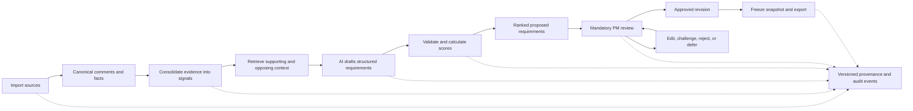

# BMW ConceptCraft AI: Core Application Implementation Plan

- **Delivery window:** 10–12 hours, five people, AI-assisted implementation
- **Product:** Evidence-backed product requirements workbench for BMW Product Managers
- **Process:** Market research and product planning, through G1 concept freeze
- **Scope:** F70, G60/G68, G70, and explicitly labeled successor/Neue Klasse proposals
- **Implementation:** React/Vite frontend, FastAPI backend, SQLite, structured LLM calls

## 1. The Tangible Product We Are Building

Build one complete decision loop:

**Import actual BMW inputs → consolidate findings → draft requirements → explain and rank them → PM review → inspect history → export the approved plan.**

The main screen is a requirements table. Clicking a row opens a workbench containing the requirement, its score explanation, original evidence, assumptions, and decision controls. This is the central product, not a dashboard around a hidden analysis script.

### 1.1 Core User Journey

1. The PM opens the app and sees the imported datasets, analysis progress, and a ranked requirements list.
2. The PM selects a derivative, target markets, and powertrains, then runs analysis or opens a previous completed run.
3. The app presents proposed requirements, each with its own evidence, score breakdown, evidence level, assumptions, and status.
4. The PM opens a requirement and follows a claim to the original spreadsheet row/cell or PDF page.
5. The PM edits a target, challenges an assumption, changes a scoring factor, approves, rejects, or defers the requirement.
6. The app saves the change, rationale, actor, time, and before/after state; relevant scores and baseline ranks update.
7. The PM selects approved requirements and creates an exportable G1 snapshot.

### 1.2 BMW Deliverables and Their Concrete Implementation

| BMW expected deliverable | What we implement | Demonstration / acceptance criterion |
| :--- | :--- | :--- |
| Concept and demonstrable AI-powered prototype processing heterogeneous inputs, deriving requirements, supporting prioritization, and integrating human review | Import pipeline, analysis service, requirements workbench, scoring service, and PM decision actions | Generate at least one new requirement from actual imported data and complete its review in the UI |
| Structured sample list with ID, actionable description, linked findings/sources, score, prioritization rationale, evidence level, future assumptions/uncertainties, and decision status | The requirements table and detail response share one structured requirement model; CSV/JSON export includes all of these fields | Every displayed/exported requirement contains these fields; evidence links resolve to stored sources |
| Defined end-to-end workflow distinguishing autonomous AI work from mandatory human review | The workflow in Section 2, analysis-run stages, and server-enforced status transitions | Explain the process from an imported record to an approved revision; AI cannot approve requirements |
| Audit trail covering sources, consolidation, scoring, prioritization, and human decisions, including changes, initiator, time, and rationale | Immutable revision snapshots plus an append-only application event stream | Show the original derivation and subsequent content, evidence, score, rank, and status changes for one requirement |

**Additional presentation output:** a 3–5 minute pitch built around the working decision loop and three verified example requirements.

### 1.3 Delivery Targets

- Import every supplied feedback row, the survey sheets, sales forecasts, and page-aware text from the option catalogs and corporate report.
- Produce an initial sample list targeting 12–18 proposed requirements across the three vehicle lines, as the evidence permits.
- Verify three showcase requirements thoroughly: strong support, a real trade-off, and an explicit evidence gap.
- Support live generation for a bounded selection of signals, with real cached results available for a reliable walkthrough.
- Have the first real end-to-end requirement working by hour 3.

The essential build is the workbench, generation, ranking, review, audit, and export. Weight sensitivity and regional comparison are additions after that loop works. Separate Kanban, graph visualization, elaborate dashboards, SSO, and full engineering feasibility automation are outside this delivery window.

### 1.4 Final Deliverable Bundles

These are the outputs to have ready for BMW at the end of implementation; this document specifies the build, rather than claiming these outputs already exist.

| Bundle | Concrete artifacts | What BMW can inspect |
| :--- | :--- | :--- |
| **1. Concept and working prototype** | Backend/frontend source, README with setup/startup instructions, configured sample analysis, and a running application | Actual imports, new AI-generated requirements, explained ranking, contextual review chat, and PM decisions |
| **2. Structured requirements sample** | In-app list plus `var/exports/requirements.csv` and `requirements.json` | Every required field from Section 6, including findings/sources, score rationale, evidence level, assumptions, uncertainty, and status |
| **3. End-to-end workflow** | Workflow diagram and AI/PM responsibility table from Section 2, included in the project documentation and presentation | Autonomous processing, persisted proposals, acceptance of edits, mandatory approval, and export gates |
| **4. Demonstrable audit trail** | In-app history, revision diffs, `var/exports/audit.json`, and the frozen review-package manifest/checkpoint | Source-to-decision lineage and changes to consolidation, content, evidence, scores, ranks, and status, with initiator/time/rationale |

The frozen G1 package is the approved-decision export within these bundles. Include a 3–5 minute pitch and three verified demonstration cases. Exported BMW evidence stays in the local/private delivery bundle, not the public repository. The 12–18 requirement target is a team goal, not a BMW-mandated minimum.

## 2. Workflow and AI/Human Responsibilities



| Activity | Implementation | Authority |
| :--- | :--- | :--- |
| Parse, normalize, deduplicate comments, calculate counts | Deterministic Python code | Automatic; preserve originals and report import issues |
| Group topics, extract issue spans, retrieve relevant context | Imported annotations, explicit rules, and bounded model-assisted analysis | Automatic proposals; retain assignment method and source locations |
| Draft requirement, metric, alternatives, and assumptions | Structured LLM output | Proposed content only |
| Compute factor scores, evidence index, and ranking | Versioned deterministic scoring code | Automatic calculation; PM can override factors with rationale |
| Validate a proposed target or accept an extrapolation | PM review controls | Mandatory human judgment |
| Approve, reject, defer, reopen, or freeze | Backend decision service | PM action required |

Opening a detail panel is read-only. AI never changes an approved requirement in place. A changed requirement becomes a new revision requiring review.

### 2.1 Workflow Graph and Evidence Graph

Implement the workflow as a Python state machine in `analysis.py`, with each completed stage checkpointed in `analysis_runs`. Specialist model roles handle signal extraction, requirement drafting, and contextual review; they share the provider adapter and validated evidence contracts. Deterministic services own import, counts, score calculation, ranking, persistence, and decision transitions.

The two graphs serve different purposes:

- **Workflow graph:** `consolidate → retrieve → draft → validate → score → propose → human review → decision/export`. Initial generation follows predefined retrieval steps; contextual review can choose additional read-only tools within a bounded loop.
- **Evidence graph:** requirement revision → signal revision → feedback spans → source rows, plus requirement/score → survey/sales facts → cells, strategy/equipment chunks → PDF pages, and revision → decisions/history. SQLite identifiers and joins preserve these relationships.

Persist run context: entity IDs/revisions, planning scope, source/config versions, retrieved evidence IDs, model/prompt version, tool calls, validation failures, and result/suggestion IDs. A PM review is a saved state awaiting a later UI action; no background worker remains blocked while the PM thinks.

### 2.2 Two Human Gates

1. **Accept an edit:** the assistant presents a cited explanation, proposed field diff, and score preview. The PM applies, edits, or discards the proposal. Applying creates an auditable new revision and may invalidate prior approval.
2. **Approve the requirement:** a separate PM action approves the current revision after reviewing targets, scope, evidence, and assumptions. Accepting an assistant suggestion does not approve it.

Read-only questions and discarded suggestions leave requirement content, scores, ranks, and decision status unchanged. Natural-language requests to approve or reject lead to the corresponding UI decision control; the assistant itself has no decision-write authority.

## 3. Architecture and Repository Structure

### 3.1 Runtime

- **Backend:** FastAPI, Pydantic, Uvicorn, SQLite; OpenPyXL/Pandas for workbooks; PyPDF or pdfplumber for PDFs.
- **Frontend:** React, TypeScript, Vite, Tailwind, Lucide, TanStack Query. Add charts only where a simple table is insufficient.
- **LLM:** one OpenAI-compatible provider through `llm_client.py`, configured with `LLM_API_KEY`, `LLM_BASE_URL`, and `LLM_MODEL`.
- **Retrieval:** SQLite FTS5 for lexical retrieval in the core build. Persisted embeddings plus NumPy cosine search can be added behind the same retrieval interface.
- **Execution:** one backend process with a background analysis worker. Persist run state in SQLite; no separate queue infrastructure.
- **Python:** start with the existing 3.14 environment. Confirm dependency installation in hour 1; use a compatible pinned runtime if a required dependency blocks the build.

SQLite stores authoritative relationships and revisions. The retrieval index only selects candidate evidence; it never becomes the source of truth for counts or citations.

### 3.2 Proposed Files

```text
backend/
  app/
    main.py                   # FastAPI app, routes, lifespan
    config.py                 # Environment and model configuration
    db.py                     # Connections, schema setup, transaction helper
    schemas.py                # Shared Pydantic request/response contracts
    cli.py                    # Import, analysis, and audit verification commands
    ingestion/
      feedback.py             # Comments, raw rows, and annotations
      studies.py              # CN/EU means and US rating distributions
      sales.py                # Vehicle-line/region/year facts
      documents.py            # Page-aware PDF extraction
      mappings.py             # Countries, powertrains, categories, vehicle lines
    services/
      sources.py              # Source records and citation resolution
      signals.py              # Topic buckets, issue evidence, distinct counts
      retrieval.py            # Relevant study/option/strategy evidence
      tool_registry.py        # Typed read-only tool schemas and server-side dispatch
      llm_client.py           # Structured output, bounded retry, caching
      analysis.py             # Run orchestration and draft validation
      review_assistant.py     # Scoped chat, tool loop, validated pending suggestions
      scoring.py              # Factors, intervals, ECI, ranking
      decisions.py            # Edits, transitions, revisions, challenge application
      audit.py                # Events, hash chain, history queries
      export.py               # Sample list and frozen G1 package
  tests/
frontend/
  src/
    api/                      # API client and types generated from OpenAPI
    components/
      RequirementsTable.tsx
      RequirementWorkbench.tsx
      SmartEditor.tsx
      EvidencePanel.tsx
      ScoreBreakdown.tsx
      DecisionDialog.tsx
      HistoryTimeline.tsx
      AnalysisRunStatus.tsx
      ReviewAssistantPanel.tsx
      ChangePreview.tsx
    pages/
      RequirementsPage.tsx
      SourcesPage.tsx
      ReviewPackagePage.tsx
    App.tsx
contracts/                    # Agreed example payloads; synthetic fixtures labeled
var/                          # Local DB, caches, extracted text, and exports
```

Keep raw BMW data and derived quotes, databases, caches, and exports out of public commits. Extend `.gitignore` for `var/` and credentials. Frontend development fixtures are synthetic and explicitly labeled.

### 3.3 Development Commands to Provide

From the repository root, after dependency installation:

```bash
.venv/bin/python -m backend.app.cli ingest --data-dir BMW-Data
.venv/bin/python -m uvicorn backend.app.main:app --host 127.0.0.1 --port 8000
npm run dev --prefix frontend
```

The CLI uses the same services as the API. Vite proxies `/api` to the backend, so the frontend has one relative API base path.

## 4. Data Model and Real Input Handling

### 4.1 Observed Data Constraints

These counts come from inspecting the supplied workbooks and must be checked again by the importer:

| File | Raw rows | Distinct feedback IDs |
| :--- | ---: | ---: |
| `F70_feedback_hackathon.xlsx` | 4,076 | 2,128 |
| `G60_feedback_hackathon.xlsx` | 5,005 | 4,000 |
| `G70_feedback_hackathon.xlsx` | 4,690 | 4,000 |
| **Total** | **13,771** | **10,128** |

Repeated IDs have the same text and different category/type annotations. Preserve the rows and annotations; count a canonical comment once per signal. These are distinct comments, not proven distinct customers.

Other important constraints:

- No China free-text feedback is supplied. China evidence comes from studies and other applicable sources.
- About 90.2% of distinct G60 comments and 94.8% of distinct G70 comments are US comments.
- F70 is ICE-only in this feedback dataset, and its supplied US/CN forecast volumes are zero.
- China 5 Series studies refer to G68; EU studies refer to G60. Regional differences may also reflect derivative differences.
- `BEVE` is a source value; normalize it to `BEV` while retaining the original.
- Feedback lacks dates. The core app shows coverage and sentiment/type distribution, not sentiment velocity.

### 4.2 Storage Contract

Use relational identifiers and JSON payloads for complex versioned structures to keep implementation short. All source-derived entities point to immutable source versions.

| Table | Essential fields / purpose |
| :--- | :--- |
| `source_files` | `id`, filename, SHA-256, kind, imported timestamp, import summary; same file hash is idempotent |
| `source_records` | `id`, `source_file_id`, locator JSON, raw payload JSON, optional `feedback_id`; one record per spreadsheet row or extracted fact location |
| `feedback_comments` | `id`, source version, original ID, source label, derivative, country, region, normalized/original powertrain, original text |
| `feedback_annotations` | `id`, `feedback_id`, `source_record_id`, original feedback type and VFC level 2/3 labels |
| `facts` | `id`, kind (`survey`, `sales`, `option`), derivative/line, region, powertrain if known, year, metric, value/distribution, unit/scale metadata, source record references |
| `document_chunks` | `id`, source file, 1-based PDF page, optional printed page label, chunk text, derivative/market metadata; FTS5 index |
| `signals` | Composite key `(id, revision)`, title, category, source scope, consolidation method/configuration, summary JSON, analysis run ID |
| `signal_links` | Signal ID/revision, feedback ID, original-text span, polarity, assignment method, annotation/source references; distinct comment counting despite multiple spans |
| `requirements` | `id`, current revision, current status, approved revision or null; compact current-state index |
| `requirement_revisions` | Composite key `(req_id, revision)`, full requirement payload, score breakdown, evidence links, source/signal versions, actor, timestamp, rationale |
| `analysis_runs` | `id`, kind (`import`, `analysis`, `challenge`), requested scope, source/config versions, stage, state, progress counts, failures, timings, model/prompt version, result IDs |
| `review_threads` | `id`, entity kind (`signal`, `requirement`), entity ID, created actor/time; conversation bound to one selected insight or requirement |
| `review_turns` | `id`, thread ID, expected entity revision, run ID, PM question/rationale, cited answer, tool/context references, optional field diff/score preview, proposal state, applied revision or null |
| `scoring_configs` | `id`, formula version, factor weights, thresholds, normalization reference, forecast year; immutable once used |
| `ranking_snapshots` | `id`, scoring config, requirement revisions, baseline ID-to-rank/score mapping, timestamp, triggering event |
| `audit_events` | `id`, entity type/ID/revision, UTC time, actor kind/ID, action, before/after JSON, rationale, run/config references, previous/current hash |
| `freeze_snapshots` | `id`, selected approved revisions, source/config versions, accepted assumptions, ranking snapshot, audit checkpoint, actor, timestamp, complete export payload |

Enable SQLite foreign keys and WAL. Add indexes for feedback scope, source references, requirement status, and audit entity/time. Serialize writes through transactions; do not share one live connection across worker threads.

### 4.3 Feedback Import

1. Read the `Feedback_Explorer` sheet and map columns by header name, not position.
2. Save every original row with a locator such as `{"sheet":"Feedback_Explorer","row":3}`; row numbers include the header.
3. Canonicalize by source-file version plus supplied feedback ID. Verify that repeated IDs have consistent text and metadata; report collisions instead of silently merging inconsistent records.
4. Save each annotation separately. A comment may contain both positive and negative annotations.
5. Map `BEVE → BEV`, countries to the agreed commercial regions, and VFC categories to the topic taxonomy. Store mapping versions.
6. Preserve missing labels. Any added label records its method and is stored separately from the imported annotation.
7. Flag empty/non-informative text for analysis exclusion while retaining the source. Do not discard meaningful short text solely because it is under 12 characters.

The sales workbook calls its Europe region `EU`. Document the commercial mapping for GB, Norway, and other European countries rather than treating the label as strict EU membership.

### 4.4 Studies and Sales Import

- **CN/EU studies:** walk category/`Mean` row pairs; identify derivative and region from the multi-row headers. Preserve each numeric cell, metric, and locator.
- **US studies:** parse question blocks and seven rating categories into distributions. `Sample total = 1` is a 100% distribution total, not one respondent. Preserve unknown respondent counts as null.
- Keep native scales. Never equate a CN/EU mean with a US distribution without an explicitly recorded transformation. Broad satisfaction measures cannot prove a specific interface preference.
- Map topics to related study questions through a small reviewed mapping file. Mark the relation `direct`, `broad`, `contradictory`, or `unmapped`, with a reason.
- **Sales:** read F70, G60_G68, and G70 sheets into line/region/year facts for 2024, 2025, and 2030. Treat G60_G68 as one sales line, not two volumes to sum.
- Sales do not supply a powertrain split. A BEV-only proposal using whole-line volume must label it as an upper-bound proxy; no invented BEV share.

### 4.5 PDF Import and Citation Retrieval

- Extract each page from the three option PDFs and `BMW-Group-Report-2025-en.pdf`; record extraction failures/empty pages.
- Chunk within pages, approximately 600–1,000 words per chunk, keeping the page boundary and exact original text.
- For showcase requirements, verify the actual option codes/package facts and strategy passages used. Store selected equipment facts with source-page references; general-purpose table reconstruction is not required.
- German catalog facts retain the original wording. Translations are separate derived text, and German packaging is not automatically asserted for other markets.
- `GET /api/sources/{id}` returns file metadata; `/api/source-records/{id}` returns the exact workbook row/cells or extracted fact, and `/api/document-chunks/{id}` returns cited page text. The PDF file endpoint supports opening the cited page with `#page=N`.

## 5. How the Analysis Produces Requirements

### 5.1 Signals: A Bounded, Implementable First Pass

Start with approximately 8–12 in-scope topics: HVAC operation, infotainment/navigation, connectivity, seating/comfort, storage/space, visibility, charging UX, perceived range, driving experience, and equipment packaging. Final names come from inspected VFC categories.

1. Map imported annotations into topic buckets per derivative. Keep positive, negative, and request evidence distinct.
2. Calculate distinct-comment bucket counts and regional/powertrain coverage in SQL.
3. Select up to 24 comments per bucket for initial discovery: different sources/markets/powertrains where available, positive counterexamples, and recurring friction. Record the selection method and cap; do not call it statistically representative.
4. Ask the model to propose issue-specific signals and return exact original-text spans with feedback IDs and polarity.
5. Validate that each span is a substring of the referenced original comment. Invalid citations are rejected, not repaired by inventing text.
6. Persist the validated issue evidence as `signal_links`. Wider bucket members remain retrieval candidates until actually assigned to that issue.
7. Where useful, an explicit phrase rule can scan the full bucket to add matches with the rule/version recorded. Show whether membership is model-assigned, rule-assigned, imported, or PM-confirmed.

**Two counts must stay separate:** `topic_bucket_comment_count` describes the broad topic; `issue_support_comment_count` describes validated evidence for the specific issue. Never attach the entire HVAC bucket count to one narrower physical-button proposal.

Initial generation processes at most four selected issue signals per vehicle line, targeting 12 drafts. A subsequent run can extend the list toward 18 after review. This keeps latency, model cost, and citation review bounded while every raw source remains available for search. Counts from bounded discovery are lower bounds, not an exhaustive estimate of issue frequency; retain the unassigned candidate counts and mark this limitation.

### 5.2 Context Retrieval

For each issue signal, construct an evidence pack containing:

- Up to eight supporting and four opposing issue spans, selected with scope/source diversity, with their source IDs and scope. Counts come from all persisted assignments, not only the snippets in this pack.
- The mapped survey facts and mapping strength.
- Applicable sales facts for the proposed scope.
- Up to three relevant option chunks and three strategy chunks, filtered by derivative where appropriate.
- Missing-market, missing-scale, packaging, and future-platform limitations.

Use FTS search terms from the topic and issue title plus reviewed bilingual aliases for German catalogs. Return source IDs, exact text, and metadata, not an untraceable generated summary. The model receives only these supplied identifiers and may cite only them.

### 5.3 Structured Requirement Drafting

`draft_requirement(signal, evidence_pack, planning_scope)` returns validated JSON containing:

- Title and clear customer-facing requirement description.
- The evidence-backed problem, kept separate from the suggested solution.
- SMART fields: specific scope, measurable target/unit/test conditions, attainability rationale, relevance, and target milestone.
- Claim-to-evidence references for the problem, rationale, strategy, and packaging statements.
- Alternative solution suggestions when the evidence supports more than one approach.
- Initial severity/strategic-fit/effort proposals with reasons, not a model-generated final priority number.
- Future assumptions, limitations, contradictory evidence, and unresolved validations.

Every metric, milestone, architecture assertion, and package suggestion has provenance: `SourceBacked`, `AIProposed`, or `PMEntered`, plus a review state. AI-proposed targets are displayed as proposals, not engineering facts.

For example, complaints about difficult access to temperature controls can justify a usability requirement. A suggested maximum interaction count is a proposed acceptance target until reviewed. They do not establish an exact latency threshold, SOP year, existing camera architecture, or commercial uplift.

### 5.4 Draft Validation and Persistence

Pydantic validates the output shape. Service validation checks:

1. IDs refer to supplied evidence and source versions.
2. Quoted spans are exact; fact values match the stored facts.
3. Supporting customer evidence exists for the problem statement, or the draft explicitly identifies a study-only basis.
4. Markets, powertrains, source derivatives, and target derivatives are explicit.
5. A narrow requirement does not claim the full topic count as support.
6. Unsupported quantitative claims and future assumptions are labeled.
7. Regulatory engineering and detailed component/BOM specifications do not replace the customer-facing requirement.

Citation/number checks establish traceability, not semantic proof that a passage entails the claim. The draft records its interpretation for PM review.

Then the backend assigns a unique requirement ID, calculates scores and evidence quality, saves revision 1 with status `Proposed`, records the derivation, and refreshes the baseline ranking. Invalid drafts are retained as run failures for inspection but do not appear as valid proposed requirements.

Implementation sequence inside `analysis.py`:

```python
async def derive_one(signal, scope, run_id):
    pack = retrieval.build_evidence_pack(signal, scope)
    draft = await llm.draft_requirement(signal, pack, scope)
    validated = validate_draft(draft, pack, signal)
    scores = scoring.calculate(validated, signal, baseline_config)
    evidence = scoring.assess_evidence(validated, signal, pack)
    # No network/model calls inside the database write transaction.
    with db.transaction():
        requirement = revisions.create_proposed(validated, scores, evidence, run_id)
        audit.record_derivation(requirement, signal, pack, run_id)
        ranking.refresh_baseline(trigger=requirement.id)
    return requirement.id
```

This shows the path for a new requirement; the service checks cached/existing derivations before entering it. Imports, model calls, and evidence retrieval remain independently callable/testable modules.

### 5.5 Run Behavior and Failure Handling

Run stages: `import_check → consolidate → retrieve → draft → validate → score → completed`.

Run states: `queued`, `running`, `succeeded`, `partial`, `failed`. Return a run ID immediately, show progress, and poll while running. Execute one generation run at a time in the first build.

- Cache by source/config versions, signal revision, scope, model, prompt version, and retrieved-context hash.
- Cached derivations return existing requirement IDs without duplicating or overwriting them. Regenerating an existing requirement produces a pending suggestion/diff for PM application, preserving the current revision and decision.
- Use a bounded concurrency limit and at most one structured-output repair attempt per draft; transient provider errors receive bounded backoff.
- Save valid requirements even if another signal fails, and report partial results.
- On restart, mark interrupted runs `failed` with reason `interrupted`, rather than leaving them permanently running.
- Missing credentials or unavailable providers produce a visible failure/configuration state. Cached results are labeled cached; no fabricated successful AI run.

### 5.6 Tool-Enabled Review Assistant

Expose typed function tools through `tool_registry.py`; the server dispatches them to existing services. Tools return structured identifiers, source locations, exact text/facts, counts, and explicit missing-data results.

| Tool | Inputs | Output / service |
| :--- | :--- | :--- |
| `search_feedback` | Query, derivative/region/powertrain scope, limit | Original comments, matching spans, source references, and candidate/membership distinction |
| `get_signal_evidence` | Signal ID/revision | Supporting/opposing evidence, distinct counts, assignment coverage, and gaps |
| `get_survey_facts` | Topic and scope | Native study values/distributions, cells, mapping strength, unknown sample/scale metadata |
| `get_sales_volume` | Vehicle lines, regions, forecast year | Deterministic applicable volume, fact references, missing splits, proxy assumptions |
| `search_documents` | Query, document kind, derivative/market scope, limit | Equipment/strategy chunks with exact text and PDF page references |
| `get_requirement_context` | Requirement ID/revision | Current reviewed content, scores, assumptions, evidence, and selected history |
| `preview_requirement_change` | Requirement ID/expected revision and allowed field patch | Validated hypothetical content, recalculated score/ECI/rank effects, and unresolved checks; no writes |

The review service loads the selected entity and current revision before a model turn. It sends the PM question, relevant prior visible conversation, pinned context, and tool schemas. The model can request tools, receive results, and produce an answer or pending suggestion.

Implementation limits:

- At most six tool invocations and four model round-trips per turn, including repair attempts; bounded result sizes. Return a partial answer with its limitation if the budget is exhausted.
- Server validates tool arguments and uses parameterized queries and registered source IDs. Tools cannot execute arbitrary SQL, access arbitrary files, or modify requirements.
- Record tool inputs/results and their source versions with the turn/run so the answer is reconstructable.
- Feedback/documents are evidence content, not instructions for the assistant. Only the registered tool schemas and service policy determine execution.
- The model can propose edits to title/description, SMART fields, target scope, assumptions, evidence links, and scoring-factor assessments. It cannot patch source text, calculated scores, status, actor, revision number, or audit history.
- Every suggested patch is validated and previewed by the backend, even if the model did not call the preview tool itself. New evidence must resolve to real stored identifiers.

Final review result: cited `answer`, `coverage_gaps`, optional `proposed_patch`, server-calculated `score_preview`, `base_revision`, and proposal state (`none`, `pending`, `applied`, `discarded`, `stale`). Persist it before displaying it. Model failure does not prevent ordinary form-based PM edits.

## 6. The Requirement Contract

The backend owns this contract; frontend types are generated from OpenAPI. Complex fields live in the revision payload so history can reconstruct exactly what the PM reviewed.

| Field | Required contents |
| :--- | :--- |
| `id`, `revision` | Stable unique identifier and version number |
| `title`, `description`, `problem_statement` | Actionable customer-facing wording and the originating need |
| `source_scope` | Source derivatives, regions, powertrains, and relevant signal revisions |
| `target_scope` | Target derivative/vehicle line, regions, powertrains; successor mapping if applicable |
| `smart` | Specific, measurable target/unit/conditions/verification method, attainability, relevance, milestone; provenance and review state for targets/assertions |
| `finding_links` | Signal versions and issue-level evidence identifiers |
| `evidence_links` | Source/record/chunk IDs, locators, claim key, relation (`supports`, `contradicts`, `context`), and validation state |
| `score` | Calculated and effective priority, factor values/contributions, input references, override if any, configuration ID, provisional flag, range |
| `prioritization_rationale` | Deterministic explanation of main score drivers plus grounded trade-off notes |
| `evidence` | ECI value/level, component values, distinct supporting comments, coverage, and explicit gaps |
| `assumptions`, `uncertainties` | Future-facing statements, missing evidence, owner/review state, and any PM acceptance rationale |
| `status`, `approved_revision` | Decision state and the exact revision approved, if any |
| `run_id`, `created_at`, `updated_at` | Derivation/run references and timestamps |

Source scope and target scope are separate. A G60 complaint can inform a successor proposal, but the app must label the carryover assumption rather than claiming successor architecture compatibility.

## 7. Deterministic Scoring and Evidence Quality

### 7.1 Priority Formula

Normalize all four factors to `[0,1]`:

```text
Priority = 100 × (0.40 × CustomerValue
                + 0.25 × AddressableReach
                + 0.20 × StrategicFit
                + 0.15 × EaseOfImplementation)
```

Weights are an explicit PM policy, not learned truth. Store them with the formula version. The core build uses one immutable baseline config; what-if previews do not silently change the baseline or approvals.

**Customer value:**

- Severity levels 1–4: cosmetic/minor friction; repeated usability friction; core experience unreliable or difficult; core experience unavailable/major recurring blocker.
- `severity = level / 4`, with source-linked rationale and an explicit provisional marker for AI estimation.
- For each applicable observed region, `p_r = distinct issue-support comments / distinct available comments in the matching source-derivative/powertrain cohort`.
- `mention = sqrt(mean(p_r))` across observed target regions. Show per-region denominators; missing regions are gaps, not zero demand.
- `CustomerValue = 0.60 × severity + 0.40 × mention`.
- This is a within-dataset mention signal, not population prevalence. Study-only drafts have a provisional customer factor until PM judgment; survey measures appear as corroboration rather than being silently mixed across scales.
- If issue assignment covered only a discovery subset, treat `p_r` as a lower bound and flag the customer factor provisional. Its upper bound includes still-unassigned candidate comments in that topic/cohort; expose the resulting score range rather than implying an exhaustive count.

**Addressable reach:**

- Sum applicable 2030 sales facts over unique `(vehicle_line, region)` keys.
- `AddressableReach = target_volume / reference_volume`.
- `reference_volume` is the fixed total of the supplied 2030 forecast across all supported lines/regions, saved in the config; it does not depend on the currently visible requirements.
- Mark future-line carryover forecasts and whole-line powertrain proxies as assumptions. Zero-volume F70 US/CN scope is surfaced explicitly.

**Strategic fit:** levels 0–4, mapped to `level / 4`: explicit conflict, limited alignment, partial alignment, strong alignment, direct strategic contribution. Require a cited strategy passage and a rationale. Missing assessment is unknown, not verified neutral alignment.

**Ease of implementation:** complexity levels 1–5: software/UI change; calibration/configuration; existing hardware/packaging change; new subsystem integration; major architecture change. `Ease = (5 - complexity) / 4`. This is a rough proposal, not an engineering feasibility certificate.

Entirely unknown factors use a clearly marked provisional midpoint of `0.5`; expose a score range calculated with their lower/upper values of 0/1. Partially observed customer factors use the lower-bound/range rule above. Do not display an unknown factor as a sourced fact. Targets with no valid comparable volume require a provisional reach factor.

The baseline ranks current `Proposed`, `UnderReview`, and `Approved` requirements. `Rejected` and `Deferred` retain scores/history but have no active rank. Sort by effective score descending, then requirement ID for deterministic ties. Keep calculated score and any PM score override separately. Content/evidence changes clear an old override unless the PM explicitly reaffirms it with a new rationale.

### 7.2 Evidence Confidence Index

Implement a transparent rubric, not a probability of correctness:

```text
ECI = 100 × (0.35 × support
           + 0.25 × coverage
           + 0.25 × corroboration
           + 0.15 × assignment_validation)
```

- `support = min(1, log(1 + distinct_support_comments) / log(51))`. For study-only cases with unknown respondent counts, use a conservative 0 in the headline index, label the component unknown, and show its possible contribution range; do not manufacture comment counts.
- `coverage` is the fraction of target regions with applicable customer feedback or a relevant mapped study. Show which type each region has.
- `corroboration`: 0 for no independent relevant support, 0.5 for broad same-topic support, 1 for directly relevant corroboration; contradictory evidence is separately flagged.
- `assignment_validation`: mean membership-review value, 0.5 for traceable but unreviewed imported/rule/model assignment and 1 for PM-confirmed assignment. For study-only evidence use the mapping-review value instead; untraceable assignments are rejected.
- Evidence levels: `Low < 40`, `Moderate 40 ≤ ECI < 70`, `High ≥ 70`; thresholds and components are versioned policy choices.

Always show low-support warnings, unknown respondent counts, source concentration, future assumptions, and regional gaps alongside the index. High ECI does not establish an AI-proposed target or architecture claim. Priority and ECI are independent; do not hide promising low-evidence requirements by multiplying the scores.

### 7.3 Regional Differences and Optional Sensitivity

- Different satisfaction means produce a `satisfaction_difference` observation, not an inferred preference for touch versus physical controls.
- Explicit opposing preferences produce a `supported_conflict` with both evidence sets.
- Missing regional evidence produces a `coverage_gap`.
- G60 versus G68 comparisons include a derivative-confounding note.
- Where a real conflict exists, draft alternative regional scopes for PM review.
- A preview endpoint accepts alternate factor weights and returns old/new scores, rank movement, and drivers. Preview results are labeled and excluded from baseline audit/approval mutations.

## 8. PM Review, Revisions, and Audit

### 8.1 Status Model

Persistent statuses: `Proposed`, `UnderReview`, `Approved`, `Rejected`, `Deferred`.

```text
Proposed → UnderReview                 explicit Start review
Proposed / UnderReview → Approved      PM approval, validation, rationale
Proposed / UnderReview → Rejected      PM rationale
Proposed / UnderReview → Deferred      PM rationale
Approved / Rejected / Deferred → UnderReview   explicit reopen/edit
```

Challenge is an action with a separate run/result, not a new decision status. G1 inclusion is a freeze-snapshot selection, not another ambiguous status.

### 8.2 Editing and Decisions

Every requirement content/evidence/score/status mutation includes `expected_revision`, actor identity, and rationale. The server reads the current revision, validates the action, builds a complete new revision, recomputes affected factors, records the event, and refreshes baseline ranking within one transaction. Challenge requests record an event/run but do not create a content revision until applied.

Return HTTP 409 on stale revisions and let the UI reload/compare. Return 422 for missing rationale or invalid transitions. Use server-confirmed updates for approval/edit actions; do not show an optimistic approval before it succeeds.

Approval requires:

- Complete, actionable SMART fields, including a measurable acceptance target and milestone.
- At least one valid underlying finding/study source link.
- PM review of proposed targets and milestone, and explicit acceptance or resolution of feasibility/scope assumptions.
- The current reviewed revision; any later content, evidence, or score edit clears approval and creates an `UnderReview` revision.

The prototype uses a named PM selector as actor identity. AI/system events identify the model/run or service. This supports the demonstrable workflow; enterprise authentication is a later integration.

### 8.3 Contextual Chat and Challenge Action

Each signal or requirement has a contextual review thread. The PM can ask a question, challenge evidence, request a narrower scope, or suggest a target change. The service retrieves pinned context and uses the tools in Section 5.6, then returns cited reasoning, coverage gaps, and an optional proposed diff.

Record the request and response. Do not mutate the requirement until the PM selects **Apply suggestion**, confirms the diff, and supplies a rationale. Applying uses the original expected revision; a stale result must be reviewed again.

Example interaction, with actual retrieved citations replacing the example's generic descriptions:

1. PM asks: **“Does this evidence justify a global requirement?”**
2. Assistant examines supporting comments, regional coverage, and mapped study facts. If only US evidence supports the specific preference, it explains the gap rather than inventing a China preference.
3. Assistant proposes narrowing target scope and adding a regional validation assumption. The UI shows before/after fields and a backend-calculated priority preview.
4. PM selects **Apply**, optionally edits the proposal, and enters the rationale.
5. Backend checks the revision, validates the allowed patch and evidence, creates a new revision, recomputes affected scores/ECI/ranking, and records changes in one transaction. An approved item becomes `UnderReview`.
6. PM separately selects **Approve** after reviewing the resulting revision and assumptions.

Signal-only conversations can request **Create requirement draft**, which submits the selected signal to the normal analysis/validation/scoring path. Read-only insight discussion does not mutate signal membership. Requirement conversations can modify a pending suggestion; direct form edits remain available for simple changes.

A follow-up turn retains previous visible conversation but reloads the current entity revision. If the requirement changed, flag older patches as stale and regenerate their previews. Selecting **Discard** records the suggestion outcome without changing the requirement.

### 8.4 Events and Reconstructability

Record these event categories:

| Event | What must be reconstructable |
| :--- | :--- |
| `SOURCE_IMPORTED` | File version, parser/mapping version, row counts, exclusions/errors |
| `SIGNAL_CONSOLIDATED` / `SIGNAL_REVISED` | Membership, consolidation method, counts, source scope, before/after signal snapshots |
| `REQUIREMENT_DERIVED` | Signal/source versions, retrieved evidence, run/model/prompt references, initial content |
| `CONTENT_CHANGED` / `EVIDENCE_CHANGED` | Previous/new revision and exact field/evidence changes |
| `SCORE_CALCULATED` / `SCORE_OVERRIDDEN` | Inputs, formula/config, factor contributions, original/effective score, rationale |
| `RANKING_RECALCULATED` | Previous/new baseline ID-to-rank map, scores, context, trigger; visible moves for affected requirements |
| `STATUS_CHANGED` | Actor, previous/new status, approved revision, decision rationale |
| `CHALLENGE_REQUESTED` / `CHALLENGE_COMPLETED` | PM question, cited response, proposed diff, application state |
| `SUGGESTION_APPLIED` / `SUGGESTION_DISCARDED` | Turn/run reference, proposed versus accepted patch, PM rationale, resulting revision or no-op outcome |
| `FREEZE_CREATED` | Approved revisions, source/config versions, accepted assumptions, actor, checkpoint |

Every event has UTC time, initiator kind/ID, entity/version, and a non-empty human or generated rationale. Store model output/context references locally for AI derivations; generation is not claimed to be mathematically deterministic.

Audit view combines requirement events with its linked signal/run/source events so the PM can follow the complete chain. Ranking history uses the baseline full-list context; sorting/filtering a table changes only the view and is not a governance event.

For tamper evidence, hash canonical event JSON plus the previous event hash. Provide a verifier and include the checkpoint in the exported package. This is a tamper-evident local ledger relative to a trusted checkpoint, not a claim that a database administrator cannot rewrite history.

## 9. API and Frontend Contracts

### 9.1 API Endpoints

| Endpoint | Purpose / payload |
| :--- | :--- |
| `GET /api/sources` | Import state, file hashes, row/comment counts, parsing issues |
| `GET /api/sources/{id}` | Source file metadata and import state |
| `GET /api/source-records/{id}` | Exact workbook row/cell or extracted fact with original locator |
| `GET /api/document-chunks/{id}` | Exact cited PDF text and page metadata |
| `GET /api/sources/{id}/file` | Allowlisted imported PDF download/view |
| `POST /api/import-runs` | Import the configured local BMW dataset; returns an analysis-compatible run ID |
| `POST /api/analysis-runs` | Requested scope, selected signals/topics, max drafts, refresh/cache option; returns run ID |
| `GET /api/analysis-runs/{id}` | State/stage, progress, failures, model/cache mode, resulting requirement IDs |
| `GET /api/signals` | Consolidated findings with scope, distinct counts, and evidence links |
| `POST /api/review-threads` | Bind a contextual conversation to a signal or requirement ID |
| `GET /api/review-threads/{id}` | Visible turns, citations, suggestion states, and current entity revision |
| `POST /api/review-threads/{id}/turns` | Question, expected entity revision, actor, rationale; returns a challenge run ID |
| `POST /api/review-threads/{id}/turns/{turn_id}/discard` | Mark a pending suggestion discarded, actor and rationale; no requirement mutation |
| `GET /api/requirements` | Paginated/searchable table; derivative, region, powertrain, status, evidence filters |
| `GET /api/requirements/{id}` | Complete current revision, score, uncertainty, and decision controls |
| `GET /api/requirements/{id}/evidence` | Supporting/opposing/context evidence, locators, facts, regional coverage |
| `PATCH /api/requirements/{id}` | SMART/scope/evidence/factor edits plus expected revision, actor, rationale |
| `POST /api/requirements/{id}/decisions` | Start review, approve, reject, defer, or reopen; expected revision and rationale |
| `POST /api/requirements/{id}/challenges` | Convenience wrapper creating/reusing a requirement thread and submitting a turn; returns run ID |
| `POST /api/requirements/{id}/challenge-applications` | Turn/run reference, expected revision, accepted allowed diff, actor, rationale; apply one proposal once |
| `GET /api/requirements/{id}/history` | Revision diffs and linked consolidation/scoring/ranking/decision events |
| `GET /api/requirements/{id}/history/export?format=json` | Download the reconstructable requirement history and referenced context |
| `GET /api/requirements/export?format=csv\|json` | Structured sample list, including linked evidence, score rationale, ECI, assumptions, status |
| `POST /api/freezes` | Selected requirement IDs/revisions, expected baseline ranking ID, actor, rationale |
| `GET /api/freezes/{id}` | Immutable review-package snapshot |
| `GET /api/freezes/{id}/export?format=markdown\|json` | G1 package from the stored snapshot |
| `GET /api/freezes/{id}/audit` | Audit bundle with revision/tool references and complete chain prefix through the snapshot checkpoint |
| `POST /api/scoring/preview` | Optional sensitivity preview; no baseline writes |

Register the static `/api/requirements/export` route before the `/{id}` route. Run polling uses a common response shape for import, analysis, and challenge jobs.

All contextual chat uses the same review service. The convenience challenge route is an adapter, not a second implementation. Applying a proposal is idempotent by turn ID; an identical repeat request returns the original application result rather than creating another revision. A conflicting reapplication returns 409. Record the application result and requirement mutation in the same transaction.

Example approval request:

```json
{
  "action": "approve",
  "expected_revision": 3,
  "actor_id": "pm-demo-1",
  "rationale": "Reviewed linked evidence and accepted the proposed usability target for concept planning.",
  "accepted_assumption_ids": ["assumption-1"]
}
```

The server determines the new revision, status, timestamp, score, and events. The client cannot submit a fabricated approval state or final calculated score.

### 9.2 Main Screen

Header: dataset/run state, **Run analysis**, **Export sample list**, **Create review package**.

Filters: source/target derivative, region, powertrain, status, evidence level, text search.

Table columns: rank, ID/title, target scope, effective priority, evidence level, uncertainty/conflict badges, status. Row selection opens the workbench. Empty, failed, partial, and cached states are explicit.

### 9.3 Workbench

Use tabs or sections within one large drawer/panel:

- **Requirement:** problem, description, editable SMART fields, target provenance, alternatives, assumptions.
- **Why this priority:** four factor values, weighted contributions, input references, provisional range, override controls, generated score rationale.
- **Evidence:** verbatim spans, source/type, worksheet/cell/page link, support/opposition label, bucket-versus-issue counts, regional coverage and survey context.
- **Review assistant:** scoped conversation, clickable citations, visible retrieval progress, coverage gaps, and a change-preview card with Apply/Edit/Discard controls. Applying and approving are separate buttons/actions.
- **History:** chronological events and revision diff, including score/rank/status moves.

Persistent actions: **Start review**, **Edit**, **Challenge**, **Approve**, **Reject**, **Defer**. A decision dialog requires rationale and shows outstanding targets/assumptions. Invalid actions are disabled and server-enforced.

After a confirmed mutation, invalidate requirement detail/list, history, and ranking queries. Preserve unsaved editor state if an API request fails. Show a reload/compare prompt for HTTP 409.

### 9.4 Sources and Review Package Screens

The sources screen shows actual imported counts, source errors, region/powertrain coverage, and source previews. The review-package screen shows selected approved revisions, unresolved-but-accepted assumptions, baseline scores, and snapshot/download controls.

Keep the BMW-inspired styling consistent: navy `#061a38`, blue `#1c69d4`, neutral slate, amber for uncertainty. Prioritize legible evidence and review controls over decorative charts.

## 10. Export Behavior

### 10.1 Structured Sample List

CSV/JSON export includes ID, revision, description/SMART fields, linked finding/source identifiers and locators, score and factor breakdown, prioritization rationale, evidence index/level, future assumptions, uncertainties, and decision status.

JSON retains nested structures. CSV flattens the main fields and serializes evidence/assumption arrays predictably; it must not silently omit them.

### 10.2 Frozen G1 Package

`POST /api/freezes` validates that each supplied revision is current and approved and that the baseline ranking context has not changed. It captures full requirement payloads, score/configuration, source/signal versions, decisions, accepted assumptions, and an audit checkpoint in one transaction.

Generate Markdown and JSON from that stored snapshot. Later edits to a requirement do not change an existing package. PDF can be added using browser print after the core exports work.

The Markdown package contains an executive summary, prioritized approved list, SMART descriptions, source references, scoring rationale, confidence/coverage, open validations, and decision history. Include a machine-readable manifest and checkpoint for verification.

### 10.3 Audit Export

Provide `GET /api/freezes/{id}/audit` and a JSON download on the history view. For a freeze, export the relevant chronological source/run/signal/requirement/ranking events, revision snapshots, and visible tool/assistant records needed to reconstruct each selected decision.

Hash-chain verification requires the complete event prefix through the stored checkpoint, or an explicit proof linking omitted events. The core build exports the complete prefix plus selected-requirement references so a verifier does not mistake a filtered event list for a complete chain. Write `audit.json` and the manifest beside the review package in the private export bundle.

## 11. Five-Person Implementation Split

| Owner | Primary files / responsibility | First integration handoff |
| :--- | :--- | :--- |
| **1 — Data and provenance** | `ingestion/*`, source service; imported comments/annotations, survey/sales facts, page-aware documents | Actual feedback import and source-resolving evidence payload by hour 2 |
| **2 — AI and consolidation** | Signal/retrieval/tool/LLM/analysis/review services; structured drafting and scoped chat | One valid AI draft with real source IDs by hour 2.5–3 |
| **3 — Backend and decisions; integration lead** | Schema/contracts, scoring, revisions, audit, API, freeze/export | List/detail/edit/decision APIs and one transactional audit path by hour 2.5 |
| **4 — Core PM workbench** | App shell, requirements page/table, SMART editor, decision dialogs, review-assistant panel/change preview | Table → detail → edit/approve using agreed contracts by hour 3 |
| **5 — Evidence and verification UI** | Evidence panel, score explanation/history, sources/package UI; demo stewardship | Verbatim evidence and score breakdown for the first real requirement by hour 3 |

Owner 3 approves shared schema and API contract changes; Owner 1 supplies the provenance schema. Agree these in the first 45 minutes so work can proceed in parallel. Frontend works from labeled contract fixtures until the actual API arrives, then switches to real responses.

Each human can delegate bounded tasks to coding agents: a workbook parser, a specified UI component, the scoring module, a revision/audit service, or citation verification. Give agents file ownership, input/output contracts, and completion checks. Use separate worktrees where useful; avoid simultaneous edits to shared contracts/configuration.

### 11.1 Milestones

| Time | Team goal | Required evidence of completion |
| :--- | :--- | :--- |
| **0–0.75h** | Freeze contracts, enums, mappings, scoring policy, provider, schema, and candidate demo topics | Shared payloads and a runnable backend/frontend skeleton |
| **0.75–3h** | Build the first vertical slice in parallel | Actual feedback → signal → AI draft → score → PM decision → persisted audit event, all visible in the UI |
| **3–6h** | Complete heterogeneous context and sample generation | Studies/sales/PDF evidence resolves; list spans the supported lines; assumptions and source gaps display |
| **6–8h** | Complete required workflow and exports | Content/evidence/factor edits, challenge, status transitions, rank history, sample export, frozen review package |
| **8–10h** | Validate and polish | Three source-checked showcase requirements, essential integration checks, complete walkthrough and pitch |
| **10–12h** | Buffer and optional differentiation | Sensitivity/regional comparison only if the full core loop is stable; startup/restart and rehearsal complete |

If the hour-3 loop is incomplete, work through that dependency before expanding the feature surface. A requirement card containing only hand-written sample text does not satisfy this milestone.

## 12. Verification and Demonstration

### 12.1 Meaningful Checks

- **Import correctness:** expected raw/distinct counts; repeated-ID annotations survive; mixed positive/negative comments remain multi-topic; rerunning the same import is idempotent.
- **Provenance:** sampled comments, survey cells, volume facts, and cited PDF passages match the actual source. All generated citation IDs resolve.
- **Signal counts:** duplicate annotations and multiple spans do not inflate distinct-comment support; broad bucket counts cannot become narrow-issue counts.
- **Scoring:** factors stay bounded, weights sum to one, missing inputs remain provisional, same inputs/config reproduce scores, volume keys are not double-counted, complexity importance affects scores as specified.
- **Workflow:** AI cannot approve; a blank rationale fails; stale revision fails; editing an approved requirement invalidates approval; failed writes cannot leave an unlogged state change.
- **Review assistant:** retrieval uses real identifiers; read-only chat/discard cannot mutate requirements; pending edits have validated score previews; applying once creates one revision; stale suggestions cannot overwrite newer work; applying never implicitly approves.
- **History:** derivation, consolidation, evidence edits, factor/score changes, resulting rank moves, and PM decisions are reconstructable with actors/times/reasons.
- **Freeze:** unapproved/stale revisions cannot be frozen; changing the live requirement does not change an existing package; all required sample-list fields survive export.
- **Recovery:** cached/live runs are distinguished, partial failures display, saved decisions/history survive restart, and changed audit events fail verification against the trusted checkpoint.

Use focused backend/integration tests for these invariants and one browser walkthrough. Avoid spending the window on exhaustive UI unit tests.

### 12.2 Three Showcase Cases

Select cases after inspecting actual evidence; do not hard-code assumed complaint counts or regional preferences.

1. **Strong support:** recurring issue with valid quotes and relevant corroboration.
2. **Trade-off:** a genuine conflict or two plausible solutions with traceable evidence and effort differences.
3. **Evidence gap:** a valuable successor/regional proposal whose applicability or target needs validation.

The demonstration follows one case through drafting, score explanation, original evidence, PM modification, approval, history, and export. The other two show why uncertainty and trade-offs are useful decision outputs.

### 12.3 Definition of Done

- [ ] Prototype imports the supplied heterogeneous data and exposes actual import/coverage state.
- [ ] A new proposed requirement can be generated from real findings in the app.
- [ ] The structured sample list contains every BMW-required field and exports successfully.
- [ ] Every requirement has traceable findings/sources and a reproducible score rationale.
- [ ] Proposed targets, future assumptions, evidence gaps, and conflicts are visible.
- [ ] PM edit, challenge, approve, reject, and defer work with revisions and rationale.
- [ ] Contextual chat retrieves cited evidence and presents changes that a PM explicitly applies, edits, or discards before a separate approval.
- [ ] Audit history traces sources → consolidation → requirement → score/rank → human decision.
- [ ] Relevant content, evidence, score, priority, and status changes record initiator, timestamp, and rationale.
- [ ] Approved revisions can be frozen/exported without later edits altering the snapshot.
- [ ] Three verified examples and a rehearsed 3–5 minute pitch demonstrate the complete core loop.

**Measure the prototype's actual contribution:** time to first cited draft, time to review a requirement, and traceability coverage. Present acceleration of these activities rather than claiming the entire two-year development process has been eliminated.
