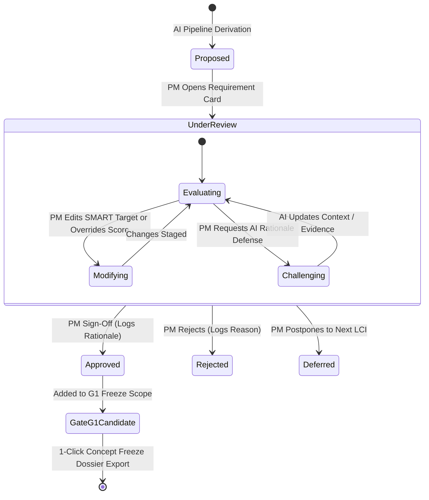

# BMW ConceptCraft AI: Technical Implementation Plan

**Solution:** AI-Powered Product Requirements Intelligence & PM Decision Cockpit  
**Target Vehicle Scope:** BMW 1 Series (F70), 5 Series (G60/G68), 7 Series (G70), and Neue Klasse Successor Line  
**Target Process:** Automotive Development Steps 1 & 2 $\to$ Gate G1 (Concept Freeze)  
**Architecture Pattern:** Hybrid Knowledge Graph + Vector Store (GraphRAG) with Human-in-the-Loop Governance  

---

## 1. System Architecture Overview

The system consists of three integrated layers:
1. **Data Ingestion & Hybrid Intelligence Layer (Python/FastAPI)**: Ingests heterogeneous customer feedback, market studies, sales projections, option catalogs, and corporate strategy decks into a unified GraphRAG database.
2. **Deterministic Algorithmic Engines**: Autonomous signal clustering, SMART requirement formulation, explainable multi-factor scoring, and uncertainty quantification.
3. **Interactive PM Decision Cockpit (React/Vite/Tailwind)**: High-fidelity executive interface enabling Product Managers to review, override, challenge, and approve requirements with an immutable audit trail.

```mermaid
flowchart TD
    subgraph S1["1. Heterogeneous Data Ingestion"]
        D1["Customer Feedback (13.7k Rows)<br/>F70, G60, G70 (US, EU, JP, KR)"]
        D2["Customer Studies<br/>EU, US, China Likert Benchmarks"]
        D3["Sales Volumes<br/>2024, 2025, 2030 Projections"]
        D4["Option Catalogs<br/>Official German Equipment PDFs"]
        D5["400-Page Corporate Deck<br/>Strategic R&D & Delivery Trends"]
    end

    subgraph S2["2. Hybrid Storage & Retrieval (GraphRAG)"]
        direction LR
        VEC["Vector Engine (Embeddings)<br/>Semantic Similarity & Document Chunks"]
        REL["Relational & Knowledge Graph (SQLite)<br/>Deterministic Lineage, Findings & Audit Nodes"]
        VEC <--> REL
    end

    subgraph S3["3. Autonomous AI & Algorithmic Engines"]
        direction TB
        E1["Signal & Kano Clustering Engine<br/>Groups Complaints, Detects Patterns"]
        E2["SMART Requirement Formulator<br/>Generates Specific, Measurable KPIs"]
        E3["Multi-Factor Prioritization Engine<br/>Score = (Value + Volume + Strategy) / Effort"]
        E4["Trustworthy AI & Conflict Radar<br/>Evidence Confidence Index & Trade-off Flags"]
        E1 --> E2 --> E3
        E2 -.-> E4
    end

    subgraph S4["4. Human-in-the-Loop PM Decision Cockpit (UI)"]
        direction TB
        UI1["Executive Overview Dashboard<br/>Volume Trends & Sentiment Velocity"]
        UI2["Requirements Studio<br/>Kanban & Data Table with Filter Gates"]
        UI3["Regional Divergence Matrix<br/>Side-by-Side EU vs US vs China Analysis"]
        UI4["Evidence Lineage Drawer<br/>Verbatim Quote Drilldown & Data Gaps"]
        UI5["PM Governance Modal<br/>Approve | Reject | Challenge | Override Score"]
        UI1 --- UI2 --- UI3
        UI2 --> UI4
        UI4 --> UI5
    end

    subgraph S5["5. Enterprise Governance & G1 Gate Deliverable"]
        AUDIT["Immutable Audit Ledger<br/>Chronological Change & Rationale Log"]
        DOSSIER["Gate G1 Concept Freeze Dossier<br/>Exportable Executive Review Package"]
        AUDIT --> DOSSIER
    end

    S1 --> S2
    S2 --> S3
    S3 --> S4
    UI5 --> AUDIT

    classDef default fill:#ffffff,stroke:#000000,color:#000000,stroke-width:1px;
    style S1 fill:#ffffff,stroke:#000000,stroke-width:1.5px,color:#000000
    style S2 fill:#ffffff,stroke:#000000,stroke-width:1.5px,color:#000000
    style S3 fill:#ffffff,stroke:#000000,stroke-width:1.5px,color:#000000
    style S4 fill:#ffffff,stroke:#000000,stroke-width:1.5px,color:#000000
    style S5 fill:#ffffff,stroke:#000000,stroke-width:1.5px,color:#000000
```



---

## 2. Database Design & Data Pipeline

### 2.1 Hybrid Knowledge Graph + Vector Schema
A pure vector database lacks the deterministic lineage required for automotive compliance, while a pure relational database cannot perform semantic clustering across unstructured reviews. We implement a **Hybrid GraphRAG** schema:

```sql
-- Core entities in SQLite relational graph
CREATE TABLE findings (
    finding_id TEXT PRIMARY KEY,           -- e.g. 'G60-0412'
    derivative TEXT NOT NULL,              -- 'F70', 'G60', 'G70'
    country TEXT NOT NULL,                 -- 'US', 'DE', 'GB', 'JP', 'KR'
    engine_type TEXT NOT NULL,             -- 'ICE', 'BEVE', 'PHEV'
    feedback_type TEXT,                    -- 'Likes', 'Difficult to Use', 'Defect', 'Wants'
    raw_text TEXT NOT NULL,
    vfc_category TEXT,                     -- Level 2 category
    sentiment_score REAL,                  -- -1.0 to 1.0
    is_imputed INTEGER DEFAULT 0           -- 1 if missing fields were inferred
);

CREATE TABLE signals (
    signal_id TEXT PRIMARY KEY,            -- e.g. 'SIG-G60-CLIM-01'
    derivative TEXT NOT NULL,
    title TEXT NOT NULL,
    category TEXT NOT NULL,                -- 'Infotainment', 'Climatization', 'Ergonomics'
    kano_classification TEXT NOT NULL,     -- 'Must-Have', 'Performance', 'Delighter'
    frequency_count INTEGER NOT NULL,
    severity_weight REAL NOT NULL,
    market_distribution TEXT NOT NULL      -- JSON: {"US": 0.72, "EU": 0.20, "RoW": 0.08}
);

CREATE TABLE signal_finding_links (
    signal_id TEXT,
    finding_id TEXT,
    PRIMARY KEY (signal_id, finding_id),
    FOREIGN KEY(signal_id) REFERENCES signals(signal_id),
    FOREIGN KEY(finding_id) REFERENCES findings(finding_id)
);

CREATE TABLE requirements (
    req_id TEXT PRIMARY KEY,               -- e.g. 'REQ-G60-CLIM-002'
    signal_id TEXT,
    derivative_scope TEXT NOT NULL,        -- 'G60', 'Cross-Platform', 'Neue Klasse'
    title TEXT NOT NULL,
    -- SMART specifications stored in structured JSON
    smart_specific TEXT NOT NULL,
    smart_measurable TEXT NOT NULL,        -- Explicit KPI thresholds
    smart_attainable TEXT NOT NULL,
    smart_relevant TEXT NOT NULL,
    smart_timely TEXT NOT NULL,            -- e.g. 'SOP 2028'
    recommended_package TEXT NOT NULL,     -- 'Standard', 'Innovation Package'
    -- Scoring breakdown
    customer_value_score REAL NOT NULL,    -- 1.0 - 10.0
    market_volume_score REAL NOT NULL,     -- 1.0 - 10.0
    strategic_fit_score REAL NOT NULL,     -- 1.0 - 10.0
    complexity_score REAL NOT NULL,        -- 1.0 - 5.0
    priority_score REAL NOT NULL,
    -- Uncertainty and Trustworthy AI metadata
    evidence_confidence REAL NOT NULL,     -- 0% - 100%
    conflict_flag INTEGER DEFAULT 0,       -- 1 if regional conflict exists
    conflict_notes TEXT,
    key_assumptions TEXT,
    -- PM Decision Status
    status TEXT NOT NULL DEFAULT 'Proposed', -- 'Proposed', 'UnderReview', 'Approved', 'Rejected', 'Challenged'
    pm_decision_rationale TEXT,
    FOREIGN KEY(signal_id) REFERENCES signals(signal_id)
);

CREATE TABLE audit_log (
    log_id INTEGER PRIMARY KEY AUTOINCREMENT,
    req_id TEXT NOT NULL,
    timestamp TEXT NOT NULL,
    actor TEXT NOT NULL,                   -- 'AI Engine' vs 'PM User'
    action TEXT NOT NULL,                  -- 'CREATED', 'SCORE_OVERRIDDEN', 'STATUS_CHANGE', 'EDITED'
    previous_state TEXT,                   -- JSON snapshot
    new_state TEXT,                        -- JSON snapshot
    rationale TEXT NOT NULL,
    FOREIGN KEY(req_id) REFERENCES requirements(req_id)
);
```

### 2.2 Missing Field Handling & Imputation Pipeline
In the raw data, $1,087$ F70 entries and $731$ G60 entries lack `Feedback Type`, and many lack `Vfc Category`. We resolve this deterministically:
1. **Length & Quality Filter**: Records with raw text $< 12$ characters or non-informative text (`"Good"`, `"N/A"`) are tagged as `Low-Signal` and excluded from core clustering.
2. **Zero-Shot Heuristic Classifier**:
   * Evaluates text syntax and vocabulary:
     * *Praise keywords* (`"love"`, `"great"`, `"smooth"`, `"pleased"`) $\to$ `Feedback Type: Likes`.
     * *Ergonomic/friction phrases* (`"hard to find"`, `"took time to figure out"`, `"complicated"`, `"distracting"`) $\to$ `Feedback Type: Difficult to Use`.
     * *Failure/bug phrases* (`"glitch"`, `"broke"`, `"freezes"`, `"doesn't connect"`, `"error"`) $\to$ `Feedback Type: Defect`.
     * *Desire/request phrases* (`"wish"`, `"would be nice"`, `"needs"`, `"should offer"`) $\to$ `Feedback Type: Wants`.
3. **Category Imputation**: For `no_class_found` or missing categories, match against an automotive ontology regex dictionary (e.g., `["screen", "display", "touch", "menu", "idrive"]` $\to$ `Touch screen, operation`).
4. **Honesty Tagging**: Records with imputed fields are flagged `is_imputed = 1`. If a derived requirement relies heavily on imputed rows, its **Evidence Confidence Index** is penalised and flagged to the PM.

### 2.3 Ingesting the 400-Page Strategic & Sales Report Deck
The 400-page corporate report is ingested through a **Page-Aware Dual-Stream Pipeline**:
1. **Structural Section Parser**: Splits the document along native chapter and slide headers:
   * *Section A: Global Delivery & Regional Sales Share (BEV vs ICE, Sedan vs SUV)*
   * *Section B: Neue Klasse Platform Strategy & R&D Priorities*
   * *Section C: ConnectedDrive, My BMW App & Digital Software Ecosystem*
2. **Dual-Stream Representation**:
   * **Narrative Chunks**: Indexed into vector search with exact metadata (`{page: 142, section: "Neue Klasse Architecture", topic: "800V Fast Charging"}`).
   * **Tabular Extracts**: Key delivery and growth numbers parsed into structured JSON to provide ground truth for market demand weighting.
3. **Citation Anchor**: Every strategic fit score links directly to a cited report page (e.g., `[BMW Group Report, p. 118]`).

---

## 3. Algorithmic Engines

### 3.1 Explainable Multi-Factor Prioritization Model
Prioritization scores must be mathematical, reproducible, and explainable:

$$\text{Priority Score} = \frac{\left( \text{Customer Value} \times W_{\text{CV}} \right) + \left( \text{Market Volume} \times W_{\text{MV}} \right) + \left( \text{Strategic Fit} \times W_{\text{SF}} \right)}{\text{Implementation Complexity} \times W_{\text{IC}}}$$

#### Factor Calculation:
* **Customer Value ($1.0 - 10.0$)**:
  $$\text{Customer Value} = \min\left(10, \; \left( \log_2(\text{Signal Count} + 1) \times 1.8 \right) + \text{Severity Bonus} + \text{Kano Weight}\right)$$
  * *Severity Bonus*: Defect ($+2.0$), Difficult to Use ($+1.5$), Wants ($+1.0$).
  * *Kano Weight*: Must-Have ($+2.5$), Performance ($+1.5$), Delighter ($+1.0$).
* **Market Volume Factor ($1.0 - 10.0$)**:
  * Directly computed from `sales_volumes.xlsx` addressable 2030 forecast for targeted regions.
  * Normalizes the combined addressable volume: $V_{\text{target}} / V_{\text{max\_fleet}} \times 10.0$.
* **Strategic Fit ($1.0 - 10.0$)**:
  * Evaluates alignment with BMW Group strategic pillars: Neue Klasse platform readiness, circular sustainability, software-defined vehicle OTA, and premium brand perception.
* **Implementation Complexity ($1.0 - 5.0$)**:
  * Level 1: Minor Software OTA / UI adjustment
  * Level 2: Existing sensor/module calibration
  * Level 3: Interior trim / minor hardware packaging change
  * Level 4: New subsystem / supplier integration
  * Level 5: Major structural / platform architecture redesign

### 3.2 The Trustworthy AI & Uncertainty Radar ("We Reward Honesty")
Every requirement carries an **Evidence Confidence Index (ECI)**:

$$\text{ECI} = \left( 0.4 \times C_{\text{volume}} \right) + \left( 0.3 \times C_{\text{source\_purity}} \right) + \left( 0.3 \times C_{\text{survey\_correlation}} \right)$$

* $C_{\text{volume}}$: Scaled based on sample size ($> 50$ citations = $1.0$, $20-50$ = $0.7$, $< 20$ = $0.4$).
* $C_{\text{source\_purity}}$: Ratio of raw ground-truth feedback vs. imputed rows ($1.0 - \text{Imputed Ratio}$).
* $C_{\text{survey\_correlation}}$: Agreement with quantitative customer study deltas ($1.0$ if backed by survey score drop, $0.5$ if neutral, $0.2$ if unmeasured).

#### Regional Conflict Detection Algorithm:
The engine flags requirements where regional customer preferences diverge significantly:
* *Example (Climatization)*:
  * EU customer feedback strongly demands physical tactile HVAC controls for Autobahn speeds.
  * China customer studies favor clean minimalist touch screens with deep AI voice interaction.
* *The System Response*:
  * Automatically sets `conflict_flag = 1`.
  * Generates an actionable trade-off recommendation: *"Recommend dual-tier specification: Standard physical quick-access bar in EU/US; Touch-first layout with haptic feedback for China G68 market."*

---

## 4. Human-in-the-Loop PM Workflow & Decision Gates



### Mandatory Human Governance Rules
1. **No Silent Changes**: An AI-generated requirement cannot automatically enter Gate G1 without explicit PM review and sign-off.
2. **Mandatory Rationale Logging**: Any status change (Approve, Reject, Challenge) or score override requires entering a PM rationale note, which is committed to the immutable audit trail.
3. **What-If Sensitivity Simulation**: PMs can interactively slide global strategy weights (e.g., *Boost China Market Weight +30%*) and view instant real-time ranking adjustments before committing.

---

## 5. Technology Stack & Component Structure

### Backend (`/backend`)
* **Runtime**: Python 3.14 (Virtual Environment `.venv`)
* **Web Framework**: FastAPI (High-performance async REST API)
* **Data Processing**: Pandas, OpenPyXL, PyPDF / pdfplumber
* **Storage**: SQLite (Embedded relational graph & audit ledger) + In-memory vector similarity index
* **Server**: Uvicorn

### Frontend (`/frontend`)
* **Framework**: React 18 with Vite
* **Styling**: Tailwind CSS (Custom BMW Executive theme: Deep Navy `#061a38`, Tech Blue `#1c69d4`, Slate `#0f172a`, Alert Amber `#f59e0b`)
* **Icons & Visuals**: Lucide React, Recharts (for volume curves, Kano distribution, and confidence radars)
* **State Management**: React Query / Context API for optimistic UI updates and live audit trail synchronization

---

## 6. Phased Implementation Roadmap

```mermaid
gantt
    title BMW ConceptCraft AI: Implementation Schedule
    dateFormat  HH:mm
    axisFormat  %H:%M
    
    section Phase 1: Data Pipeline
    Ingest Feedback, Studies, Sales, Option PDFs :p1_1, 00:00, 30m
    Clean, Filter & Impute Missing Fields        :p1_2, after p1_1, 20m
    Index 400-Page Corporate Report Chunks       :p1_3, after p1_2, 20m

    section Phase 2: Core Engines
    Signal Clustering & Kano Engine              :p2_1, after p1_3, 25m
    SMART Requirement Formulator                 :p2_2, after p2_1, 25m
    Multi-Factor Prioritizer & Uncertainty Radar :p2_3, after p2_2, 25m

    section Phase 3: Backend API
    FastAPI REST Endpoints & Query Tools         :p3_1, after p2_3, 30m
    Audit Trail & Decision Engine                :p3_2, after p3_1, 20m

    section Phase 4: Frontend Cockpit
    Executive Dashboard & Volume Views           :p4_1, after p3_2, 30m
    Requirements Studio (Kanban & Table)         :p4_2, after p4_1, 35m
    Evidence Lineage & Uncertainty Drawer        :p4_3, after p4_2, 25m
    Regional Divergence Matrix & Trade-off Tool  :p4_4, after p4_3, 25m

    section Phase 5: Polish & Verification
    Gate G1 Dossier Export (PDF/Markdown)        :p5_1, after p4_4, 20m
    End-to-End Walkthrough & Pitch Deck Prep     :p5_2, after p5_1, 25m
```



### Detailed Phase Milestones

#### Phase 1: Ingestion & Data Preparation
* Parse all $13,771$ feedback records from F70, G60, and G70 Excel sheets.
* Parse quantitative study matrices (`F70_G60_G68_G70_customer_studies.xlsx`) and regional volume projections (`sales_volumes.xlsx`).
* Extract option codes and package definitions from the German OptionList PDFs.
* Extract strategic priorities and delivery numbers from the 400-page corporate report.
* Populate the SQLite relational schema and in-memory embeddings index.

#### Phase 2: Algorithmic Engines
* Implement the signal clustering pipeline that aggregates raw findings into core themes.
* Implement the SMART requirement transformer that creates quantified, testable specifications.
* Implement the explainable scoring formula with dynamic factor weighting.
* Implement the Evidence Confidence Index (ECI) and regional conflict detector.

#### Phase 3: FastAPI Backend Services
* Build endpoints:
  * `GET /api/dashboard/overview` (high-level stats, volume trends, sentiment split)
  * `GET /api/requirements` (filterable by derivative, market, powertrain, status)
  * `GET /api/requirements/{id}/lineage` (exact feedback quotes, survey links, option specs)
  * `POST /api/requirements/{id}/decision` (approve, reject, edit, challenge + mandatory rationale)
  * `GET /api/conflicts/regional` (cross-market divergence matrix)
  * `GET /api/audit-trail` (chronological event stream)
  * `GET /api/export/g1-dossier` (formatted Gate G1 review package)

#### Phase 4: Interactive PM Cockpit UI
* Build the executive navigation and theme system.
* Build the Requirements Studio featuring:
  * Toggle between Kanban and Data Table views.
  * Deep-dive slide-over drawer showing backward lineage to verbatim quotes.
  * Trustworthy AI badge highlighting confidence score and regional conflicts.
  * Direct action buttons (Approve / Reject / Edit / Challenge) with rationale modal.
* Build the Cross-Market Divergence Matrix comparing US, EU, and China.
* Build the Live Audit Trail Viewer.

#### Phase 5: Verification & Pitch Alignment
* Verify end-to-end user journeys for F70, G60, and G70.
* Ensure all requirements adhere to the SMART framework.
* Validate that the 1-click Gate G1 export generates an executive-ready dossier.
* Prepare pitch talking points directly aligned with the 3–5 minute presentation limit.

---

## 7. Verification & Demo Scenario

To guarantee maximum impact during the evaluation pitch, the application will be demonstrated through a real-world scenario:

### The Scenario: Next-Gen BMW 5 Series / i5 (G60 Successor) for Global Markets
1. **Discovery**: The AI identifies 3 major friction signals:
   * *Signal A*: Climatization menu latency and lack of physical tactile hotkeys (41 complaints in US/EU).
   * *Signal B*: Cold-weather fast charging pre-conditioning predictability (62 BEV complaints in US/Nordics).
   * *Signal C*: Rear passenger streaming entertainment vs. chauffeur comfort (China G68 customer study gap).
2. **SMART Formulation**: System displays `REQ-G60-CLIM-002` with explicit latency and tactile feedback KPIs.
3. **Uncertainty Alert**: System warns the PM of a regional contradiction (EU demands physical dials; China favors minimalist voice/touch displays).
4. **PM Intervention**: The PM opens the review card, adjusts the specification to include market-specific console modules, overrides the strategic score to reflect Neue Klasse priorities, enters their rationale, and hits **Approve for G1**.
5. **Audit Verification**: The PM clicks the Audit Trail tab to reveal the complete, tamper-proof event record, followed by generating the **Gate G1 Concept Freeze Dossier** with 1 click.
